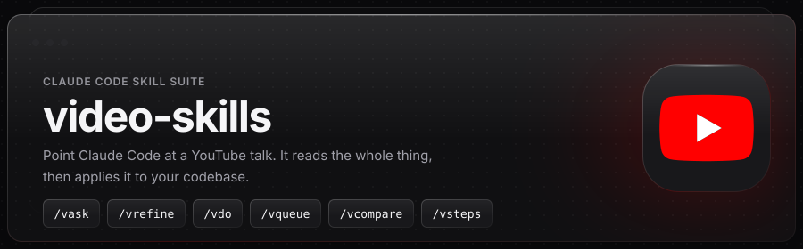

# video-skills

[](https://claude.com/claude-code)
[](https://www.python.org/)
[](docs/engine.md)
[](LICENSE)

> Claude Code skills that watch YouTube videos and apply them to your project. Paste a link: Claude reads the full transcript, captions or local Whisper, instead of guessing from the title.

Built by **[Kleos](https://github.com/kleos1337)**.

***

## What is this?

`video-skills` is a drop-in set of [Claude Code skills](https://docs.claude.com/en/docs/claude-code/skills) on top of one shared extraction engine, `shared/extract_video.py` (`yt-dlp` plus `faster-whisper`). It works with or without captions and can extract slide frames.

Four layers stack:

* **Route:** `/vask` reads the installed skills and your project, then tells you which command to run.
* **Extract:** the engine turns a URL into `transcript.txt`, plus optional `slide_NNN.png` frames.
* **Understand:** `/vrefine`, `/vsteps`, `/vcompare`, and `/vqueue` read the transcript. They produce a spec, a checklist, a comparison, or a library.
* **Ship:** `/vdo` maps the video onto your files, implements it, and runs your tests.

***

## Quickstart

```powershell
git clone https://github.com/kleos1337/video-skills.git
cd video-skills
```

```powershell
# Windows (junctions, no admin rights needed)
powershell -ExecutionPolicy Bypass -File install.ps1
```

```bash
# Linux / macOS
./install.sh
```

Both installers link every skill into `~/.claude/skills/<skill>`, link `shared/` as `~/.claude/skills/yt-shared`, and build `shared/.venv`. Restart Claude Code, then ask for what you want:

```text
> /vask I have a talk on agent harnesses and want to use it in this repo

Recommendation: /vrefine, then /vdo.
  - Your goal is to build it, but the plan isn't settled yet.
  - No docs/specs/ file exists, so there is nothing to execute.
  - /vrefine closes the open questions first. Then /vdo builds from the spec.

Run:  /vrefine https://www.youtube.com/watch?v=<id>
```

> The block above is an illustrative transcript, not recorded output.

***

## What's inside

**6 skills**, each a folder under `skills/` with one `SKILL.md`:

| Command | Role | Best for | Edits code |
|---|---|---|---|
| `/vask` | Router. Reads the suite and your project, recommends a skill, hands back the command. | You have a link or a goal and don't know where to start. | ❌ |
| `/vrefine` | Restates your goal in its own words, interviews you in rounds, writes an approved spec. | A fuzzy idea you need to pin down before any code. | ❌ |
| `/vdo` | Reads the video, maps it onto your files, implements it, runs your tests. | Applying a talk or tutorial directly to the project. | ✅ |
| `/vqueue` | Extracts a list or playlist in sequence and writes an `INDEX.md`. | Collecting talks to study later. | ❌ |
| `/vcompare` | Compares 2+ videos: agreements, disagreements, a recommendation for your project. | Choosing between competing approaches. | ❌ |
| `/vsteps` | Turns a tutorial into numbered steps with timestamps, commands, and gaps. | Following along without scrubbing the video. | ❌ |

A typical flow: `/vqueue` to collect, `/vcompare` to choose, `/vrefine` to settle the spec, `/vdo` to build.

***

## How it works



1. You give a skill a YouTube URL.
2. The engine asks `yt-dlp` for captions. If they exist, it cleans the VTT (timestamps, tags, repeated lines).
3. If there are no captions, it downloads the audio and transcribes it with `faster-whisper` on CPU, with a `[mm:ss]` marker every 2 minutes.
4. The skill reads `transcript.txt` in full (and slides, if you asked for them) and produces its result.

The engine, in one line:

```powershell
shared/extract_video.py <URL> [--out DIR] [--slides] [--scene 0.3] [--model base|small] [--langs pt,en,es]
```

| Option | Default | Description |
|---|---|---|
| `--out DIR` | `<temp>/yt_context_<id>` | Output folder. |
| `--slides` | off | Also download the video at 720p and save a frame at each scene change. |
| `--scene` | `0.3` | Scene-change threshold, 0 to 1. Lower gives more frames. `0.1` suits screen recordings. |
| `--model` | `base` | Whisper model size, `base` or `small`. |
| `--langs` | `pt,en,es` | Caption languages, in priority order. |

Full reference: [docs/engine.md](docs/engine.md).

***

## Examples

> The sessions below are illustrative. They show the shape of each flow, not recorded output.

<details>
<summary><b><code>/vrefine</code> → <code>/vdo</code>: settle the plan, then build it</b></summary>

```text
> /vrefine https://www.youtube.com/watch?v=<id>

transcript: …\yt_context_<id>\transcript.txt
source: whisper
duration: 55 min
words: 9467

Here's what I think you want, in my own words:

  Goal     Stop our agent runs from needing a human at every step.
  Problem  Long tasks stall on small approvals and nobody notices for hours.
  From the talk  The speaker splits work into verifiable units [12:40] and
                 keeps a status note the agent rewrites each tick [31:05].

Is that right, or what did I miss?

> Close, but we only care about the status note, not the unit splitting.

Updated. Round 1:

❓ **Q1** - **Where the note lives**: In the repo, or outside it?
➡️ In the repo, as `docs/status.md`, so reviewers see it in diffs.

❓ **Q2** - **Who rewrites it**: The agent at each step, or a hook after each tool call?
➡️ The agent, at the end of each task.

> yes to both

Frontier is empty. Spec written to docs/specs/status-note.md.
Do we share the same understanding?

> yes

> /vdo docs/specs/status-note.md

Plan: 3 files (AGENTS.md, docs/status.md, checks/status.ps1).
Done. Tests: 14 passed. Temp folder cleaned.
```

</details>

<details>
<summary><b><code>/vqueue</code>: run a playlist</b></summary>

```text
> /vqueue https://www.youtube.com/playlist?list=<id>

Queue: 6 items, ~3h10m of video. That's over 2 hours.
Proceed? (yes / trim)

> yes

[1/6] extracting…  captions   4,812 words   ok
[2/6] extracting…  whisper    7,340 words   ok
[3/6] extracting…  captions   3,105 words   ok
[4/6] extracting…  whisper    —             error: video unavailable
[5/6] extracting…  captions   6,022 words   ok
[6/6] extracting…  captions   2,981 words   ok

5 ok, 1 failed. Index: queue\2026-11-23\INDEX.md
Transcripts stay on disk. Next: /vcompare on items 1, 3, 5 (same topic).
```

</details>

***

## Scope

### In scope

* Reading a video's full content (captions or local Whisper) and working from the transcript
* Turning a video into a spec, a checklist, a comparison, or a transcript library
* Applying a video to the current project, with your tests as the check

### Out of scope (by design)

* **Downloading or redistributing videos.** The engine downloads media to a temp folder only to extract text and frames. It deletes the video file after extracting slides.
* **Visual understanding beyond slide frames.** Skills read the transcript and the extracted `slide_NNN.png` files, not the live video.
* **Guaranteed transcription accuracy.** Automatic transcripts misspell technical names. The skills flag doubtful terms instead of guessing.

***

## Requirements

* [Claude Code](https://claude.com/claude-code)
* Python 3.10 or newer. The installer builds a venv with `yt-dlp`, `faster-whisper`, and `av<17`.
* `ffmpeg` (on Windows, `winget install Gyan.FFmpeg`. Elsewhere, use `brew` or `apt`.)
* No GPU needed. Whisper runs on CPU.
* Node.js 18 or newer to rebuild this README (`npx readme-aura build`). Only contributors need it.

***

## Repository structure

```text
video-skills/
├── assets/
│   ├── banner.svg         Hero banner
│   └── architecture.svg   How-it-works diagram
├── docs/
│   └── engine.md          Engine reference
├── .github/
│   ├── workflows/
│   │   └── readme-aura.yml  Rebuilds README.md from readme.source.md
│   └── PULL_REQUEST_TEMPLATE.md
├── AGENTS.md              Guide for AI agents working on this repo
├── CONTRIBUTING.md        Add a skill or change the engine
├── readme.source.md       README source. Edit this, not README.md
├── install.ps1            Windows installer (junctions)
├── install.sh             Linux/macOS installer (symlinks)
├── shared/
│   └── extract_video.py   yt-dlp + VTT cleanup + faster-whisper + slides
└── skills/
    ├── vask/              router
    ├── vrefine/           interview → spec
    ├── vdo/               video → code
    ├── vqueue/            batch extraction
    ├── vcompare/          multi-video comparison
    └── vsteps/            tutorial → steps
```

***

## Notes

* The `SKILL.md` files use Windows paths. On other systems, replace `.venv\Scripts\python.exe` with `.venv/bin/python` and `%TEMP%` with `/tmp`.

***

## If you use video-skills

* **Add the topic:** put [`claude-skills`](https://github.com/topics/claude-skills) on your fork so others can find it.
* **Found a bug?** Open an [issue](https://github.com/kleos1337/video-skills/issues). A one-liner helps.
* **Built a skill?** See [CONTRIBUTING.md](CONTRIBUTING.md).

***

## License

[MIT](LICENSE)
